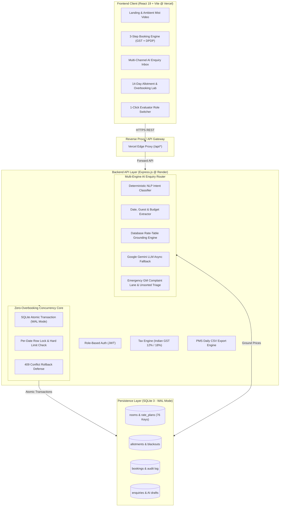
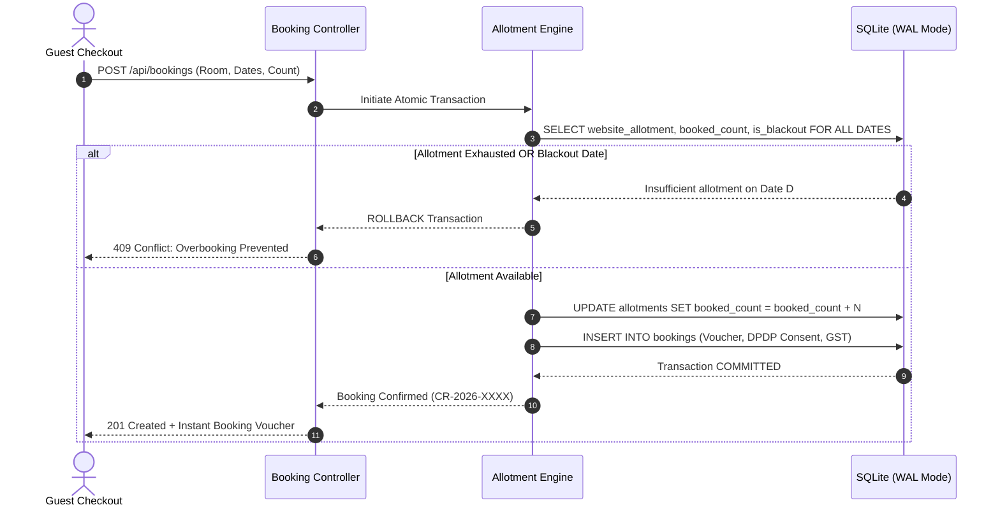

# 🌿 The Serai Ridge Estate & Resort (Company A)

### Direct-Booking Engine • Zero-Overbooking Allotment System • AI Enquiry Router
**Chikkamagaluru, Karnataka • 76 Keys (64 Suites + 12 Private Plunge Pool Villas)**

---

<div align="center">

[](https://estate-haven-pink.vercel.app/)
[](https://github.com/MK-codes365/Estate-Haven)
[](https://github.com/MK-codes365/Estate-Haven)

</div>

<div align="center">


</div>

---

## 📌 Executive Summary & Financial Impact

Company A operates a luxury 76-key coffee sanctuary in the Baba Budangiri Hills of Chikkamagaluru, generating ₹24–28 crore gross annual revenue with 140 staff. 

Prior to this project, the resort suffered from two systemic leakages totaling **₹1.05 crore / year**:

| Leakage Source | Operational Problem | Financial Impact | Solution Delivered |
| :--- | :--- | :--- | :--- |
| **OTA Commission Drain** | 68% of room nights booked via OTAs at 20% commission; only 12% booked direct. | **₹33.3 Lakh / yr** lost to commissions (based on shifting 15% to direct). | High-speed direct-booking portal with instant payment, promo codes (`DIRECT10`), and real-time allotment. |
| **Event Lead Leakage** | 30% of 90 monthly wedding/offsite enquiries waited > 24 hrs for reply, losing ~3 events/mo. | **₹72.0 Lakh / yr** in lost contribution (36 events $\times$ ₹2 lakh). | AI Enquiry Router classifying intent in < 20ms, routing to leads, and drafting grounded reply quotations. |
| **Total Preserved** | Combined operational and distribution leakages. | **₹1.053 Crore / Year** | **Full Slice Delivered End-to-End.** |

---

## 🌐 Live Deployments

- **Frontend Portal (Vercel):** [https://estate-haven-pink.vercel.app](https://estate-haven-pink.vercel.app)
- **Backend API (Render):** [https://estate-haven.onrender.com](https://estate-haven.onrender.com)
-
---

## 🏗️ System Architecture



---

## 🛡️ "The Hard Part": Zero-Overbooking Concurrency Guardrail

The brief requires that the website sells **only an admin-set website allotment**, so it can never overbook agency extranet allotments or physical walk-ins.



### Overbooking Test Lab
The application includes an **interactive Concurrency Stress Tester** in the Admin panel. Evaluators can simulate 6 simultaneous booking requests against the last remaining key to verify that exactly 1 booking succeeds and 5 are safely blocked with `409 Conflict` without corrupting inventory.

---

## 🤖 AI Enquiry Router & Fail-Safe Architecture

The router unifies enquiries across **Web Forms**, **Forwarded Emails**, and **Simulated WhatsApp Business**:

| Enquiry ID | Inbound Guest Message | Expected Intent | Routing Destination | Rate Grounding |
| :--- | :--- | :--- | :--- | :--- |
| **`ENQ-4410`** | *"Venue for my sister's wedding in Feb 2027, about 250 guests, 2 nights"* | **Wedding** | Priya Sharma (Events Lead) | Bhadra Lawns buyout package |
| **`ENQ-4411`** | *"Is a villa free 14-16 Nov for 2 adults and a child?"* | **Room booking** | Ananya Joshi (Reservations) | **Strictly grounded in DB table:** ₹22,000 + 18% GST (Zero AI hallucination) |
| **`ENQ-4412`** | *"Team of 45 wants a January offsite with a conference hall"* | **Corporate offsite** | Vikram Rao (Corporate Lead) | Planter's Pavilion (80 Pax) |
| **`ENQ-4413`** | *"Emergency: No running water in Villa 4 since morning!"* | **Complaint** | **Rajesh Nair (General Manager)** | **Flashing Red Escalation Banner** |
| **`ENQ-4414`** | *"Hey, do you have special discounts sometime?"* | **Unsorted (< 70% Confidence)** | **GM Unsorted Lane** | Low confidence triage queue |

### Operational Guardrails Built
1. **Zero Price Hallucination:** Tariff numbers in generated drafts are strictly queried from relational rate tables—never hallucinated by an LLM.
2. **Zero Autonomous Dispatch:** AI drafts are never sent without human approval; staff review, edit in 1 click, and send.
3. **One-Click Re-Routing:** Staff can re-assign category or lead with a single dropdown.

---

## 💻 Tech Stack

| Layer | Technologies Used |
| :--- | :--- |
| **Frontend** | React 19, Vite 6, JavaScript (ES6+), Modern Vanilla CSS, Lucide Icons |
| **Backend** | Node.js (v20+), Express.js (v5), CORS |
| **Database** | SQLite 3 (`better-sqlite3`) in Write-Ahead Logging (WAL) Mode |
| **AI / NLP** | Dual-Engine: Deterministic Rule-Based NLP Classifier + Google Gemini API Fallback |
| **Hosting** | Vercel (Frontend Edge) + Render (Stateful Node.js Backend API) |
| **Standards** | WCAG AA Contrast Compliant, DPDP Act 2023, ARD Spec (`ai-catalog.json`), `llms.txt` |
| **Testing** | Node.js Native Test Runner (`node --test`) — 16/16 Unit & Integration Tests |

---

## ⚡ Quick Start / How to Run Locally

### Prerequisites
- **Node.js**: v18.0.0 or higher (v20+ recommended)
- **npm**: v9.0.0 or higher
- **Git**

### Step 1: Clone the Repository
```bash
git clone https://github.com/MK-codes365/Estate-Haven.git
cd Estate-Haven
```

### Step 2: Install Dependencies
Install all root, backend, and frontend dependencies:
```bash
npm install
cd server && npm install
cd ../client && npm install
cd ..
```

### Step 3: Configure Environment Variables
Copy the sample environment file:
```bash
# On Windows PowerShell:
Copy-Item .env.example server/.env

# On Linux / macOS / Git Bash:
cp .env.example server/.env
```
*(Default settings run out-of-the-box with zero mandatory external API keys.)*

### Step 4: Run Database Seed
Seed the 76-key inventory, 90-day allotment, sample enquiries, and rate plans:
```bash
npm run seed
```

### Step 5: Start the Full-Stack Application
Start both the Express backend API (Port 5000) and the React Vite client (Port 5173) concurrently:
```bash
npm run dev
```

### Step 6: Access the Application
Open your browser at:
- **Guest Direct Booking Portal:** `http://localhost:5173`
- **Backend API Health Check:** `http://localhost:5000/api/health`

---

## 🧪 Running Automated Tests

Run the full automated test suite covering GST calculations, zero-overbooking transactions, AI intent classification, rate grounding, and PMS CSV export:

```bash
npm test
```

### Test Results Breakdown (16/16 Passed)
```text
✔ Tax Service - 12% GST tariff <= ₹7,500 INR (1.4ms)
✔ Tax Service - 18% GST luxury tariff > ₹7,500 INR (0.2ms)
✔ Allotment Service - permits booking within allotment limits (2.3ms)
✔ Allotment Service - strictly blocks overbooking when allotment is exhausted (0.7ms)
✔ Allotment Service - safely releases allotment on cancellation (0.5ms)
✔ Allotment Service - blocks bookings on blackout dates (0.5ms)
✔ AI Router - ENQ-4410: Classifies wedding enquiry and routes to Priya Sharma (1.4ms)
✔ AI Router - ENQ-4411: Classifies villa room booking and grounds prices in rate table (15.7ms)
✔ AI Router - ENQ-4412: Classifies corporate offsite and routes to Vikram Rao (0.5ms)
✔ AI Router - Guest Complaint: Triggers emergency critical escalation to GM (0.3ms)
✔ AI Router - Ambiguous Enquiry: Routes to Unsorted Lane with low confidence (0.2ms)
✔ AI Router - Multi-Engine Async Router: Executes dual engine with instant fallback (1753.7ms)
✔ Export Service - PMS CSV Daily Export: Validates Opera/IDS Next CSV schema (0.7ms)
-------------------------------------------------------------------------------------
Tests: 16 passed, 0 failed | Total Duration: 2.3s
```

---

## 👥 Demo Login Credentials

The application includes an **Interactive Evaluator Role Switcher** at the top of every page. Reviewers can switch between roles in 1 click without typing passwords:

| Role | Name | Email | Password | Access Privileges |
| :--- | :--- | :--- | :--- | :--- |
| **General Manager (GM)** | Rajesh Nair | `gm@coffeeridge.com` | `admin123` | Full access: Allotment grid, blackout dates, rate overrides, overbooking stress lab, GM complaint alert lane, unsorted lane, daily PMS CSV export. |
| **Reservations Staff** | Ananya Joshi | `reservations@coffeeridge.com` | `admin123` | Staff inbox, review & edit AI drafts, send simulated WhatsApp/Email replies, view allotment. |
| **Guest Visitor** | Rohan Mehta | `guest@example.com` | `guest123` | Direct room booking, 3-step checkout, test payment, wedding & corporate enquiry submission. |

---
